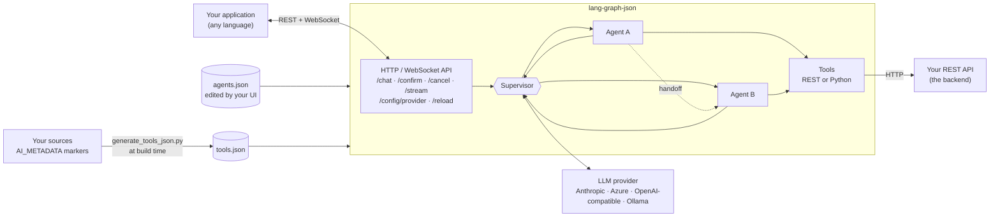

# lang-graph-json

**A generic multi-agent engine built on [LangGraph](https://langchain-ai.github.io/langgraph/), driven entirely by JSON files.**

Describe your agents in `agents.json`, your tools in `tools.json`, and get a supervisor-based multi-agent
system with human-in-the-loop confirmations, real-time streaming and hot-reload. No Python code is written
per agent or per tool.



- **JSON-driven**: agents (prompt, model, tools, confirmations, history size, handoffs) are entries in
  `agents.json`, and the tool list is generated from your source code.
- **The tool whitelist is the permission system.** An agent only sees the tools it is given. There are no
  `can_write`/`can_delete` flags.
- **Human-in-the-loop**: tools listed in `requires_confirmation` pause the graph until the user approves
  or denies them, over HTTP or WebSocket.
- **REST or Python tools**: a tool calls an endpoint of your application, or a Python function (from
  your package or from a hot-reloaded `plugins/` folder).
- **Multi-provider**: Anthropic (API key, bearer or Azure AD gateway), Azure OpenAI, any OpenAI-compatible
  endpoint, Ollama for offline use. Credentials are pushed at runtime and **never written to disk**.
- **Guards**: max tool calls per turn, token budget per session, max routing steps, tool results that are
  sanitised and size-capped.
- **Two deployment modes**: a **standalone executable** (PyInstaller, Windows/Linux) driven by any
  language, or a **Python library** embedded in your own project.
- **Generic tool parser**: `AI_METADATA({...})` markers in C++, C#, Java, TypeScript, Go, Rust, Python,
  SQL… are turned into `tools.json` at build time.

---

## Contents

1. [Quick start](#quick-start)
2. [Concepts](#concepts)
3. [Configuration files](#configuration-files)
4. [Tools: REST and Python](#tools-rest-and-python)
5. [Generating `tools.json` from your sources](#generating-toolsjson-from-your-sources)
6. [LLM providers](#llm-providers)
7. [HTTP / WebSocket API](#http--websocket-api)
8. [Standalone mode (PyInstaller)](#standalone-mode-pyinstaller)
9. [Library mode (Python)](#library-mode-python)
10. [Development and tests](#development-and-tests)
11. [Project layout](#project-layout)
12. [Security](#security)

---

## Quick start

```bash
git clone <repo> lang-graph-json && cd lang-graph-json
python -m venv .venv && . .venv/bin/activate        # Windows: .venv\Scripts\activate
pip install -e ".[dev]"

lang-graph-json --config-dir config --port 8000     # or: python -m langgraph_json
```

Push an LLM provider, then chat:

```bash
curl -X POST localhost:8000/config/provider -H "Content-Type: application/json" \
     -d '{"type": "anthropic", "api_key": "sk-ant-...", "default_model": "claude-sonnet-5-5"}'

curl -X POST localhost:8000/chat -H "Content-Type: application/json" \
     -d '{"message": "Open the document doc-42", "session_id": "s1"}'
```

No API key at hand? Use the scripted fake provider, `{"type": "fake"}`, which answers `echo: <message>`.

## Concepts

| Concept | Description |
|---|---|
| **Supervisor** | Routes each step to the right agent (or `FINISH`) using the agents' `description`. With a single agent, no routing call is made. |
| **Agent** (`react`) | An LLM with a system prompt and a whitelist of tools. It loops *LLM → tools → LLM* until it answers. |
| **Sub-graph agent** (`sub_graph`) | An agent that is itself a supervisor over `sub_agents` (hierarchical teams). |
| **Handoff** | `can_handoff_to: ["other"]` gives the agent a `handoff_to_other` tool to delegate directly, without the supervisor. |
| **Session** | A conversation (`session_id`). History is kept by a LangGraph checkpointer (in memory by default) and survives hot-reloads. |
| **Turn** | One user message. Per-turn counters (tool calls, routing steps) are reset at each turn. |
| **Confirmation** | A LangGraph `interrupt()`. The turn returns `confirmation_needed`, and `POST /confirm` resumes it. Nothing runs before every decision of a step is known. |
| **Backend** | Your application's REST API, which the REST tools call (localhost, no proxy). Its optional WebSocket feeds the built-in `wait_for_event` tool. |

Each agent sees its own tool calls natively and **the work of the other agents as text**. Histories are
therefore always valid for any provider, even when the agents have different tools.

## Configuration files

The configuration directory (`config/` by default, or `--config-dir`, or `LGJ_CONFIG_DIR`) holds three
files. The server watches them (`watch_interval_s`) and hot-reloads on change, or on `POST /reload`. An
invalid change is rejected with every error listed, and the previous configuration is kept.

### `agents.json`

```json
{
  "default_model": null,
  "default_provider": null,
  "supervisor": { "system_prompt": "Route ...", "max_steps": 10, "max_history_messages": 40 },
  "agents": {
    "jobs": {
      "display_name": "Jobs Agent",
      "enabled": true,
      "description": "Creates, runs and monitors computation jobs.",
      "system_prompt": "You are the jobs agent ...",
      "allowed_tools": ["create_job", "run_job", "get_job_status", "wait_for_event"],
      "requires_confirmation": ["run_job"],
      "max_history_messages": 40,
      "model": null,
      "provider": null,
      "can_handoff_to": ["analysis"]
    },
    "optimizer": {
      "type": "sub_graph",
      "description": "Chains analysis and jobs.",
      "system_prompt": "Coordinate ...",
      "sub_agents": ["analysis", "jobs"]
    }
  }
}
```

| Field | Default | Meaning |
|---|---|---|
| `enabled` | `true` | Disabled agents are ignored (and not validated). |
| `type` | `react` | `react`, or `sub_graph` (with `sub_agents`). |
| `description` | required | Role, shown to the supervisor for routing. |
| `system_prompt` | required | Instructions of the agent (for a sub-graph: of its supervisor). |
| `allowed_tools` | required (≥ 1) | **The permission system.** Unknown names produce a warning and are ignored. |
| `requires_confirmation` | `[]` | Tools needing user approval. |
| `max_history_messages` | server default (40) | Older messages kept before the current turn (`0` = stateless). |
| `model` / `provider` | defaults | Model name and provider name (credentials stay central). |
| `can_handoff_to` | `[]` | Direct delegation targets. |
| `routable` | `true` | `false` hides the agent from the top-level supervisor (it is then only used as a sub-agent). |

### `tools.json`

Generated at build time (see [below](#generating-toolsjson-from-your-sources)):

```json
{ "version": 1, "tools": [
  { "name": "run_job", "method": "POST", "path": "/api/jobs/{jobId}/run", "domain": "jobs",
    "description": "Starts a job.", "parameters": { "jobId": { "type": "string", "required": true } } },
  { "name": "csv_summary", "kind": "python", "callable": "my_tools.files:csv_summary", "domain": "files",
    "description": "Summarises a CSV file.", "read_only": true }
]}
```

Parameter types: `string`, `integer`, `number`, `boolean`, `array` (with `items`), `object`, plus `enum`,
`default`, `description` and `required`. Path placeholders (`{jobId}`) are always required.

### `server.json` (operational settings, never secrets)

| Key | Default | Meaning |
|---|---|---|
| `host` / `port` | `127.0.0.1` / `8000` | Bind address. Non-loopback addresses need `--allow-remote`. |
| `backend_url` | `http://127.0.0.1:8080` | Base URL called by REST tools. |
| `backend_ws_url` | `null` | Backend WebSocket of events (used by `wait_for_event`). |
| `backend_timeout_s` | `30` | Timeout of backend calls. |
| `max_tool_calls_per_turn` | `20` | Infinite-loop guard. |
| `token_budget_per_session` | `100000` | Cost guard (`0` = unlimited); a `budget.warning` event is sent at `token_alert_ratio`. |
| `default_max_history_messages` | `40` | Default for agents. |
| `max_tool_result_chars` | `8000` | Tool results are truncated beyond this size. |
| `watch_interval_s` | `2` | File watching (`0` = only `POST /reload`). |
| `python_tool_modules` | `[]` | **Whitelist** of modules usable by Python tools. |
| `plugins_dir` | `null` | Plugins folder (relative to the parent of the config directory). |
| `persistence` | `memory` | Conversation history: `memory` (nothing on disk, lost on restart) or `sqlite` (needs `pip install "lang-graph-json[sqlite]"`). Changing it requires a restart. |
| `sqlite_path` | `data/sessions.db` | SQLite file (relative to the parent of the config directory). |
| `session_ttl_hours` | `24` | Inactive sessions are deleted, in memory and on disk (`0` = never). |
| `turn_timeout_s` | `600` | A longer turn is cancelled (`0` = no limit). |
| `confirmation_timeout_s` | `900` | An unanswered confirmation is treated as denied (`0` = wait forever). |
| `maintenance_interval_s` | `10` | Period of the expiry and timeout checks. |
| `recursion_limit`, `log_level` | `200`, `info` | LangGraph recursion limit, log level. |

## Tools: REST and Python

**REST tools** (`kind: "rest"`, the default) call `method` + `path` on the backend. GET and DELETE
arguments go into the query string, the others into a JSON body.

**Python tools** (`kind: "python"`) call `callable: "package.module:function"`:

```python
from langgraph_json import AI_METADATA, ToolContext

@AI_METADATA({
    "name": "jobs_overview",
    "domain": "jobs",
    "read_only": True,
    "description": "Returns the state of several jobs in one call.",
    "parameters": {"job_ids": {"type": "array", "items": {"type": "string"}, "required": True}},
})
async def jobs_overview(job_ids: list[str], ctx: ToolContext) -> dict:
    states = {j: (await ctx.client.request("GET", f"/api/jobs/{j}"))["state"] for j in job_ids}
    return {"total": len(states), "states": states}
```

- Sync or async functions. Sync functions run in a worker thread.
- Without `parameters`, the schema is **inferred from the signature** (type hints, `Literal` → enum,
  defaults).
- A `ctx` parameter receives a `ToolContext`: the backend client, the shared folders (`ctx.shared_file()`
  refuses any path escaping them) and the backend events. It is hidden from the LLM.
- Exceptions are returned to the LLM as tool errors, so it can retry or explain.
- Only modules listed in `server.json` → `python_tool_modules` can be loaded. `agents.json` and
  `tools.json` are editable from a UI, so they must not be able to run arbitrary code.
- `plugins_dir` is added to the import path, and plugin modules are re-imported on every reload.

Built-in tools (whitelist them like any other): `wait_for_event` (wait for a backend WebSocket event instead
of polling) and `list_shared_files` (list a shared folder configured with `POST /config/paths`).

## Generating `tools.json` from your sources

Put the metadata next to the code that implements each endpoint, then generate `tools.json` at build time.
The script depends only on the standard library.

```cpp
#define AI_METADATA(...)          // no-op for the compiler

AI_METADATA({
    "name": "run_job", "method": "POST", "path": "/api/jobs/{jobId}/run", "domain": "jobs",
    "description": "Starts a job.",
    "parameters": {"jobId": {"type": "string", "required": true}}
})
std::string runJob(const std::string& jobId) { ... }
```

```bash
python scripts/generate_tools_json.py --source-dir src/ --output config/tools.json          # write
python scripts/generate_tools_json.py --source-dir src/ --output config/tools.json --check  # CI: fail if stale
```

| Option | Meaning |
|---|---|
| `--lang` | `auto` (by extension, default), `cpp`, `c`, `csharp`, `java`, `kotlin`, `js`, `ts`, `go`, `rust`, `swift`, `python`, `shell`, `sql`, `lua`. The profile gives the comment and string syntax: commented-out markers and markers inside strings are ignored. |
| `--marker` | Marker name (default `AI_METADATA`). |
| `--include-comments` | Also accept markers written inside comments (`# AI_METADATA({...})`, `/** ... */`). |
| `--ext` | Restrict the scanned extensions. |
| `--python-root` | Import root used to derive `callable` of decorated Python functions. |

It validates every block (required fields, HTTP method, types, enums, undeclared path parameters, duplicate
names or routes) and reports `file:line`. The output is deterministic (sorted by domain, then name), so a
diff in CI is meaningful. With `--lang python`, the decorator payload may be a Python dict (`True`, `None`),
and `callable` is derived from the module path and the decorated function.

### Build integration

**qmake (`.pro`)**: include the provided `.pri` at the end of your project, after `SOURCES`/`HEADERS`.
`tools.json` is then generated before compilation, and again whenever a source or header changes:

```qmake
AI_METADATA_OUTPUT = $$PWD/config/tools.json        # optional, default: $$OUT_PWD/tools.json
AI_METADATA_CHECK  = $$PWD/config/tools.json        # optional: adds "make ai_metadata_check" for CI
include(path/to/lang-graph-json/qmake/ai_metadata.pri)
```

Other variables: `AI_METADATA_SOURCE_DIRS` (default: the `.pro` directory), `AI_METADATA_PYTHON` (default
`python` / `python3`), `AI_METADATA_ARGS` (default `--lang cpp`, e.g. add `--marker MY_TOOL`). It is tested
with Qt 6 and MinGW (`mingw32-make`), MSVC (`nmake`) and Unix `make`.

**CMake**: see the `add_custom_command` in [`examples/cpp/CMakeLists.txt`](examples/cpp/CMakeLists.txt).

Examples: [`examples/cpp`](examples/cpp) (CMake and qmake) and [`examples/python`](examples/python).

## LLM providers

The provider configuration is pushed by the host application with `POST /config/provider`. It is kept
**in memory only**, and `GET /config/provider` returns it with every secret redacted.

```json
{
  "default": "gateway",
  "providers": {
    "gateway": { "type": "anthropic", "auth": "azure_ad", "endpoint": "https://llm-gateway.example.com",
                 "azure_ad": { "tenant_id": "...", "client_id": "...", "client_secret": "...", "scope": "api://.../.default" },
                 "models": ["claude-sonnet-5-5", "claude-opus-5-5"], "default_model": "claude-sonnet-5-5" },
    "direct":  { "type": "anthropic", "api_key": "sk-ant-...", "default_model": "claude-haiku-5-5" },
    "azure":   { "type": "azure_openai", "endpoint": "https://res.openai.azure.com", "api_key": "...", "default_model": "deployment" },
    "compat":  { "type": "openai_compatible", "endpoint": "https://host/v1", "auth": "bearer", "api_key": "..." },
    "local":   { "type": "ollama", "endpoint": "http://127.0.0.1:11434", "default_model": "llama3.1" }
  }
}
```

A single provider object (`{"type": "anthropic", ...}`) is accepted too. Optional fields: `temperature`,
`max_tokens`, `timeout_s`, `headers`, `api_version`. Azure AD tokens (client-credentials flow) are cached and
refreshed automatically. Proxy settings (`POST /config/proxy`: `http_proxy`, `https_proxy`, `no_proxy`) apply
to the LLM clients and to the token requests, never to the backend (localhost). `GET /config/provider/test`
checks connectivity.

### Signing in as the user (no secret on the workstation)

With the Azure AD *client credentials* flow (`auth: "azure_ad"`), every installation holds the same
`client_secret`. To avoid that, the host application can sign the **user** in (MSAL, Qt
`QOAuth2AuthorizationCodeFlow`, Windows SSO) and push the user's token instead:

```json
{ "type": "anthropic", "auth": "bearer", "endpoint": "https://llm-gateway.example.com",
  "api_key": "<user access token>", "token_expires_in": 3600, "default_model": "claude-sonnet-5-5" }
```

Before the token expires (the `provider.token_expiring` event and `token_expires_in_s` in `/status` signal
it), the host pushes the new one with `POST /config/provider/token {"token": "...", "expires_in": 3600}`.
The client is rebuilt on the next LLM call, without touching the graph or the running sessions.
`azure_openai` providers accept `auth: "bearer"` the same way (the token is sent as an Azure AD token).

## Schema versions

`agents.json` and `tools.json` carry a `"version"` field (default `1`, written by the parser). A release
supports the versions listed in `GET /status` → `schema_versions`. A file declaring a **newer** version is
refused with an explicit message ("… is not supported by lang-graph-json X — upgrade"), instead of being
misread. Older versions stay accepted. Host applications must produce files in this format, and can
check compatibility at startup through `/status`.

## HTTP / WebSocket API

All endpoints are on localhost. The OpenAPI documentation is at `/docs`.

| Endpoint | Description |
|---|---|
| `POST /chat` `{message, session_id?, agent?}` | Runs a turn. `agent` addresses one agent directly (e.g. an editor's test chat). |
| `POST /confirm` `{session_id, approved, reason?}` | Answers a pending confirmation. |
| `POST /cancel` `{session_id, reason?}` | Cancels the running turn, or the pending confirmation. It returns once the session is usable again. |
| `WS /stream?session_id=` | Events of a session (or of all sessions). Also accepts `{"type":"confirm",...}`, `{"type":"cancel"}` and `{"type":"ping"}`. |
| `POST /reload` · `POST /agent/reload` | Hot-reload the JSON files (`422` with the error list if invalid). |
| `POST /agents/validate` (body: `agents.json`) · `POST /config/validate` `{agents?, tools?, settings?}` | **Dry run**: `{valid, errors, warnings}`. Nothing is applied or written. It runs the same checks as a reload (schemas, Python imports, providers, graph build). |
| `GET /status` | State (`running` / `waiting_provider` / `error`), agents, tools, sessions, warnings. |
| `GET·POST /config/provider` · `GET /config/provider/test` | LLM providers. |
| `POST /config/provider/token` `{token, provider?, expires_in?}` | Renews a token managed by the host application (user sign-in) without rebuilding anything. |
| `POST /config/proxy` · `GET·POST /config/paths` | Proxy, shared folders. |
| `GET /tools` · `GET /agents` | What is loaded (for a configuration UI). |
| `GET /sessions` · `GET·DELETE /sessions/{id}` | History, reset. |
| `POST /shutdown` | Graceful stop (CLI mode). |

`POST /chat` response:

```json
{ "session_id": "s1", "status": "completed",
  "response": "Job J7 started.", "agent": "jobs", "route": ["jobs"],
  "tool_calls": [{"agent_name": "jobs", "tool_name": "run_job", "tool_args": {"jobId": "J7"}, "status": "ok", "result": "..."}],
  "confirmation": null, "messages": [...], "usage": {"tokens_used": 1234, "token_budget": 100000} }
```

`status` is one of `completed`, `confirmation_needed` (see `confirmation`: `tool_name`, `tool_args`,
`agent_name`), `cancelled` (by `/cancel`, by the turn timeout, or by a shutdown) or `budget_exceeded`. Errors: `503` (no provider, or invalid config), `409` (confirmation
pending, or nothing to confirm), `502` (LLM failure).

WebSocket events (`{session_id, event_type, timestamp, data}`): `agent.start`, `agent.end`, `llm.start`,
`llm.stream` (tokens), `llm.end` (usage), `tool.start`, `tool.end`, `confirmation.needed`,
`confirmation.expired`, `turn.cancelled`, `session.expired`, `budget.warning`, `config.reloaded`,
`provider.token_expiring` (5 min before), `provider.token_expired`, `chat.result`, `error`.

Typical startup sequence for a host application: launch the executable (`--port`), poll `GET /status`,
then `POST /config/provider` (and `/config/proxy`, `/config/paths`). After editing `agents.json`, call
`POST /reload`.

## Sessions: persistence, expiry, cancellation

- **No persistence (default)**: the history stays in memory. Nothing is written to disk and no extra
  dependency is needed, but a restart loses the conversations.
- **SQLite**: set `"persistence": "sqlite"` and install `pip install "lang-graph-json[sqlite]"` (the
  bundle already includes it). After a restart, sessions are restored. `POST /chat` with the same
  `session_id` continues the conversation, and a pending confirmation can still be answered. Only the
  history is stored, never the credentials.
- **Library mode**: `Runtime(checkpointer=...)` accepts any LangGraph checkpointer (e.g. Postgres), and it
  takes precedence over `persistence`.
- **Expiry**: sessions inactive for longer than `session_ttl_hours` are deleted, in memory and on disk
  (event `session.expired`).
- **Cancellation**: `POST /cancel` (a "Stop" button) or `turn_timeout_s`. The interrupted tool calls receive
  a "cancelled" result, so the history stays valid and the next message works normally.
- **Unanswered confirmations**: after `confirmation_timeout_s` they are treated as a **denial**. The agent
  is told that the user did not answer, and the session is not blocked.

## Standalone mode (PyInstaller)

For a host application written in any language (C++, C#, Java…): ship a self-contained directory with no
Python installation required, and drive it over HTTP.

```bash
pip install -e ".[dev]"
python scripts/build.py exe --zip     # dist/lang-graph-json/ + zip, with an automatic smoke test
```

```text
dist/lang-graph-json/
├── lang-graph-json(.exe)    executable: lang-graph-json --port 8000 [--config-dir DIR]
├── _internal/               Python runtime + dependencies
├── config/                  agents.json, tools.json, server.json  (default config dir)
├── plugins/                 Python tool plugins (plugins_dir)
└── generate_tools_json.py   standalone parser (any Python ≥ 3.10)
```

- Build on each target OS: PyInstaller does not cross-compile.
- Plugins can use the standard library and every bundled library. Other packages must be embedded at
  build time: `LGJ_BUNDLE_MODULES=my_tools LGJ_BUNDLE_PATHS=path/to/src python scripts/build.py exe`
  (and `LGJ_HIDDEN_IMPORTS` for extra modules).

## Library mode (Python)

```bash
pip install lang-graph-json            # or: pip install path/to/lang_graph_json-0.1.0-py3-none-any.whl
pip install "lang-graph-json[sqlite]"  # optional: SQLite persistence
```

**In-process** (no HTTP, no files):

```python
from langchain_anthropic import ChatAnthropic
from langgraph_json import Runtime

def add(a: float, b: float) -> float:
    """Adds two numbers."""
    return a + b

agents = {"agents": {"calc": {"description": "Arithmetic", "system_prompt": "Use your tool.",
                              "allowed_tools": ["add"], "requires_confirmation": ["add"]}}}

async with Runtime(agents=agents, functions=[add], llm=ChatAnthropic(model="claude-sonnet-5-5")) as rt:
    r = await rt.chat("What is 2 + 3?", session_id="s1")
    if r["status"] == "confirmation_needed":
        r = await rt.confirm("s1", approved=True)
    print(r["response"])
    rt.update_config(agents=new_agents)          # hot-reload of an in-memory configuration
```

| `Runtime(...)` argument | Meaning |
|---|---|
| `config_dir` **or** `agents=` (+ `tools=`, `settings=`) | Files (watched) or Python objects with the same schemas. |
| `functions=[...]` | Python callables registered as tools (trusted code, so no module whitelist). `@AI_METADATA` is optional: otherwise the name and docstring are used. |
| `llm=` | A LangChain chat model, or `{"provider_name": model}`. Without it, use `set_provider()` / `POST /config/provider`. |
| `checkpointer=` | Any LangGraph checkpointer (e.g. SQLite or Postgres for persistent conversations). |
| `backend_transport=` | Custom `httpx` transport (tests, in-process backend). |

**Mounted in your FastAPI app** (Starlette does not run the lifespan of mounted apps, so start the runtime
from yours):

```python
from contextlib import asynccontextmanager
from fastapi import FastAPI
from langgraph_json import Runtime, create_app

runtime = Runtime("config")

@asynccontextmanager
async def lifespan(app):
    async with runtime:
        yield

app = FastAPI(lifespan=lifespan)
app.mount("/agents", create_app(runtime, manage_lifespan=False))   # /agents/chat, /agents/stream, ...
```

**LangGraph Studio / CLI**: `langgraph.json` exposes `langgraph_json/agent.py:make_graph`. Its provider comes
from `.env` (`ANTHROPIC_API_KEY` or `LGJ_PROVIDER_JSON`).

See [`examples/embedded`](examples/embedded).

## Development and tests

```bash
pip install -e ".[dev]"
pytest                                    # offline suite (scripted LLM, mocked backend)
pytest --cov=langgraph_json               # 100 % coverage
pytest -m live -v                         # live tests against a real LLM (see below)
python scripts/build.py all               # wheel + bundle, with smoke tests
pytest -m dist -v                         # tests of the compiled bundle
```

- **Offline suite**: a scripted `FakeChatModel` (tool calls and streaming) and a mocked backend cover
  routing, handoffs, sub-graphs, confirmations, guards, streaming, hot-reload, providers, the parser, the CLI
  (a real server in a subprocess) and library mode.
- **Live tests** (`tests/test_live.py`): copy `.env.example` to `.env` and set `ANTHROPIC_API_KEY` (optionally
  `LGJ_TEST_MODEL`, default `claude-haiku-5-5`), or `LGJ_TEST_PROVIDER_JSON` for any other provider. They run
  the full stack against the real model (routing, REST and Python tools, confirmation, multi-agent chain,
  memory, streaming), and they are skipped when no credentials are found.
- **C++ example**: `cmake -S examples/cpp -B build/cpp && cmake --build build/cpp`. Its pre-build step
  regenerates `tools.json`.

CI (`.github/workflows/ci.yml`) runs on Linux and Windows: tests with a 100 % coverage gate, the
`tools.json` sync check, live tests when the `ANTHROPIC_API_KEY` secret exists, the builds and bundle tests,
and the C++ example.

## Project layout

```text
langgraph_json/
├── __init__.py          public API (lazy): Runtime, create_app, AI_METADATA, ToolContext, ...
├── __main__.py          CLI (lang-graph-json)
├── agent.py             graph construction (+ make_graph for LangGraph CLI/Studio)
├── metadata.py          AI_METADATA decorator, ToolContext
├── builtin_tools.py     wait_for_event, list_shared_files
├── tools_parser.py      generic AI_METADATA → tools.json parser (stdlib only)
├── gateway/
│   ├── app.py           FastAPI routes + WebSocket
│   └── runtime.py       config / graph lifecycle, sessions, turns, confirmations
└── utils/
    ├── state.py         shared graph state
    ├── nodes.py         supervisor, agent, tools, sub-graph nodes
    ├── tools.py         tool registry (REST + Python), schemas, sanitising
    ├── config_loader.py JSON schemas and validation
    ├── llm_factory.py   providers, Azure AD, proxy
    ├── backend_client.py REST client + backend events WebSocket
    ├── events.py        astream_events → unified events, event bus
    └── fake_llm.py      scripted model (tests / offline)
config/                  default agents.json, tools.json (generated from examples/cpp), server.json
examples/cpp/            C++ sources with AI_METADATA + CMake pre-build step
examples/python/         Python tools package (decorator, ctx, inferred schema)
examples/embedded/       library mode: in-process, mounted in FastAPI
scripts/                 generate_tools_json.py, build.py, PyInstaller entry point
tests/                   test-suite (offline, live, dist)
lang-graph-json.spec     PyInstaller spec
langgraph.json           LangGraph CLI / Studio configuration
```

## Security

| Risk | Mitigation |
|---|---|
| Agent misuses a tool | Per-agent whitelist (`allowed_tools`), enforced again at execution time. |
| Costly or destructive action | `requires_confirmation`: the graph pauses until the user approves. |
| Credential leak | Provider and proxy settings live in memory only and are redacted in every response. `.env` is for development only and ignored by git. |
| Arbitrary code through config | Python tools are limited to `python_tool_modules`. |
| Network exposure | Binds to loopback only, unless `--allow-remote` is given. |
| Infinite loops / cost explosion | Tool-call limit per turn, routing-step limit, token budget per session. |
| Prompt injection from tool results | Results are sanitised and size-capped, and the system prompts state that tool output is data, not instructions. |
| Filesystem access | Built-in and `ctx` helpers stay inside the configured shared folders. |

## License

[MIT](LICENSE)
